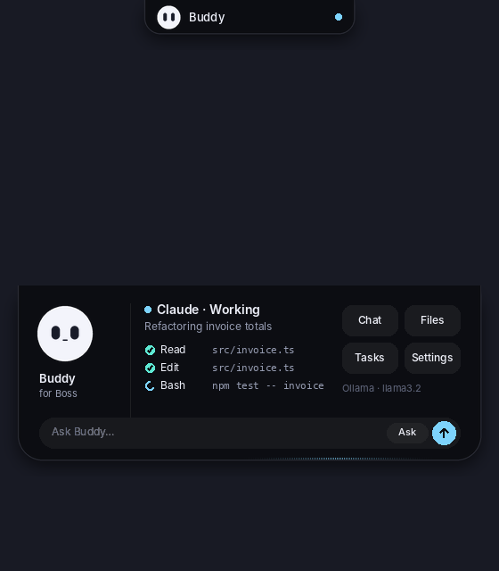

# Buddy — your AI desktop companion

**Install (Windows):** download and run [Buddy-Setup.cmd](https://github.com/teamaq416-byte/Buddy/releases/latest/download/Buddy-Setup.cmd).
Buddy installs Claude Code, Codex and Gemini (Antigravity) by itself — you only sign in in the browser.
Updates arrive automatically: Buddy checks this repo's latest release and asks you to restart.

**Release a new version:** bump nothing by hand — push a tag, e.g. `git tag v2.0.1 && git push origin v2.0.1`.
GitHub Actions runs the tests, builds the installer + update payload and publishes the release.

---

# Buddy

Two editions, same features and the same MCP tools:

- **`desktop/` — Buddy 2.0, Electron** (recommended): transparent island, web chat panel, tray, hotkey. Prebuilt portable Windows zip; `npm run package:win` rebuilds it on any OS. See `desktop/README.md`.
- **Root — Buddy 1.0, Python**: zero-dependency Tk + Pillow edition with the PyInstaller `INSTALL.cmd`. Everything below describes this one.

---

# Buddy 1.0 (Python edition)

A small, round desktop companion that lives at the top of your screen (or floats as a pet),
chats through **Ollama**, **OpenAI Codex** or **Claude Code**, and shows what your AI agents
are doing in real time — files they read, commands they run, when they need you.

No API keys. No accounts. No dependencies beyond Pillow. Everything runs locally.



## What it does

- **Island** — a notch-style pill at the top of the screen. Hover to expand: live activity feed
  (Read / Edit / Bash steps), Claude/Codex link status, quick actions. Switch to **pet** mode
  to have Buddy float anywhere and drag him around.
- **Chat in the island** — click the input at the bottom of the expanded island, type, Enter. The reply
  streams right there; click it to open the full panel. The **Ask / Do** chip switches between read-only
  chat and *Do mode*, where Codex (`--full-auto`) or Claude (`acceptEdits` + Edit/Write/Bash) actually make
  the change in your working folder while the island shows each step. Ollama always chats (no tools).
- **Chat panel** — a frameless WebView2 sheet (pywebview) that slides under the island: message bubbles,
  markdown + code blocks with copy, live tool-step timeline, slash-command palette, file chips, tasks,
  settings and connect views in one place. **Win+Shift+B** summons it from any app. If WebView2/pywebview
  is unavailable the classic Tk panel is used automatically.
- **Chat** — one panel, three providers. Switch between Ollama (any local model), Codex CLI and
  Claude Code CLI with a click. Replies stream in; tool steps are shown as they happen;
  CLI conversations resume across messages (and restarts) using their native session ids.
- **MCP bridge** — one click connects Claude Desktop, Claude Code or Codex. The AI gets
  `buddy_status`, `buddy_step`, `buddy_say`, `buddy_files`, `buddy_read_file`, `buddy_remind`,
  `buddy_task`, `buddy_tasks`, `buddy_complete_task`. Buddy animates, toasts and keeps your checklist.
- **Files** — drop files on Buddy or the chat window. Text/code files are shared with Ollama in
  the prompt; CLI agents read them with their own tools; MCP clients read them via `buddy_read_file`.
  Only attached files are ever readable.
- **Tasks & reminders** — `/task`, `/remind 10m …`, the Tasks window, or let the AI add them.
- **Planner** — Tasks, Reminders (once / hourly / daily / weekdays / weekly), Schedules (an AI task or a
  workflow on a timer, in chat or in the background), Workflows (AI · command · notify · wait steps, templates:
  Morning briefing, Playable ad QA, New build → summary, Weekly report) and Activity (background jobs, watcher alerts).
- **Assistant** — `/bg task` runs work in parallel; Buddy picks Codex for code, Claude for writing, Gemini for quick
  questions; **Ctrl+Shift+Space** on selected text in any app opens quick actions (explain, fix, translate, reply,
  summarise, review code, Replace in place); chat search across all AIs (Ctrl+F).
- **Voice** — read replies aloud (Windows voices), mic button (Windows voice typing or offline English dictation),
  optional "Hey Buddy" wake word (Windows speech recognition, on-device).
- **Watchers** — GitHub Actions runs (start / pass / fail alerts, phone too), folders (new file → tell me / ask the AI /
  run a workflow), Google Calendar meeting reminders. Google sign-in also gives the AIs `gcal_events`, `gmail_unread`,
  `gmail_search` (read-only).
- **Memory & knowledge** — profile / projects / notes plus per-folder project notes; knowledge folders are indexed
  on the PC and the most relevant passages go with every question (`buddy_knowledge` tool).
- **PC control** — `buddy_open` (URLs, files, apps), `buddy_system` (volume, media, screenshot, lock), `buddy_clipboard`,
  `buddy_background`; anything risky (apps, scripts, files outside the project, lock, risky commands) waits for Accept,
  and everything lands in Settings → Action log.

## Install (one click, Windows)

Double-click **`INSTALL.cmd`**. It finds Python 3.11+ (installs 3.12 for your user if missing),
installs Pillow/PyInstaller, builds `Buddy.exe`, installs to `%LOCALAPPDATA%\Buddy`, puts a **Buddy**
shortcut on the Desktop and Start menu, and launches it. Re-run it to upgrade (your `Buddy-data`
is kept). `UNINSTALL.cmd` removes it.

## Run from source

Python 3.11+ with tkinter (the standard installer includes it).

```
pip install pillow
python main.py
```

or double-click `run.cmd` on Windows.

## Build the portable Windows app

```
build.cmd
```

Produces `dist\Buddy\` with `Buddy.exe`, `_internal\`, `START BUDDY.cmd`. Keep the folder together.
Buddy stores state in `Buddy-data\` beside the exe (override with the `BUDDY_DATA_DIR` env var).

## Providers

| Provider | How it works | Needs |
|---|---|---|
| Ollama | `POST /api/chat` streaming; models listed from `/api/tags` | Ollama running (`ollama serve`) with a pulled model |
| Codex | `codex exec --json -s read-only`, resumed with `codex exec resume <thread>` | Codex CLI installed and signed in |
| Claude | `claude -p --output-format stream-json --include-partial-messages`, resumed with `--resume` | Claude Code installed and signed in |

Chat through the CLIs is **read-only** (`Read/Glob/Grep/Web*` for Claude, `read-only` sandbox for Codex)
and runs in the *Working folder* from Settings. For edits, use your AI app directly — connect it to
Buddy so Buddy shows its progress.

**AI tools install and update themselves.** If Claude Code, Codex or the Gemini (Antigravity) CLI is missing, Buddy
downloads it (Node.js first when Codex needs it) and you only sign in. Every 6 hours Buddy compares the installed
version with the newest one on npm and updates when a new version is out — Claude Code with its own `claude update`,
Codex with `npm i -g @openai/codex@latest`, Antigravity with winget — never while a reply is running.
Settings → **AI tools** shows each version with an Update button; switch *Install & update automatically* off to
only be told.

## Connecting AI apps (MCP)

Settings → **Connect AI apps…** (or right-click Buddy). Each button adds a single `buddy` server
entry and backs up the file it touched:

- Claude Desktop → `%APPDATA%\Claude\claude_desktop_config.json`
- Claude Code → `claude mcp add -s user buddy …` (falls back to `~/.claude.json`)
- Codex → `~/.codex/config.toml` `[mcp_servers.buddy]`

Restart the app (or start a new session) afterwards. The bridge is a tiny stdio MCP server
(`buddy/mcp_bridge.py`, shipped as `BuddyBridge.exe`) that forwards calls to the running Buddy over
loopback HTTP with a per-launch token; if Buddy is not running the tools return a clear error.

## Project layout

```
main.py                 entry point (single instance, crash log)
buddy/core.py           GUI-agnostic brain: state, providers, chat orchestration, event bus
buddy/app.py            island window (Tk), input, routing of core events, launch()
buddy/panel.py          web chat panel (pywebview) + JS↔Python API
buddy/web/panel.html    the panel UI (single file, no external assets)
buddy/hotkey.py         Win+Shift+B global hotkey
buddy/ui.py             fallback Tk panel, tasks, settings, connect dialogs
buddy/island.py         island layout, spring animation, feed, toast, hit-testing (pure PIL)
buddy/mascot.py         the round face: supersampled, cached body, expressions
buddy/compositor.py     per-pixel-alpha window (UpdateLayeredWindow) + Linux canvas fallback
buddy/dragdrop.py       native WM_DROPFILES support
buddy/providers.py      Ollama / Codex / Claude streaming providers
buddy/state.py          JSON state, tasks, reminders, files, agent activity, tool surface
buddy/server.py         loopback HTTP tool server used by the bridge
buddy/mcp_bridge.py     dependency-free stdio MCP server
buddy/connect.py        one-click MCP configuration writers
buddy/startup.py        launch-at-sign-in (HKCU Run key)
tests/                  pytest suite + Xvfb GUI smoke test
tools/make_icon.py      regenerates assets/buddy.ico and docs/preview.png
```

## Tests

```
python -m pytest -q tests                                        # core: state, bridge, providers, connect
xvfb-run -s "-screen 0 1280x800x24" python tests/smoke_gui.py out  # drives the island + Tk fallback (Linux)
python tests/panel_browser.py out                                  # drives the web panel in Chromium (Playwright)
```

## License

MIT — see [LICENSE](LICENSE).
